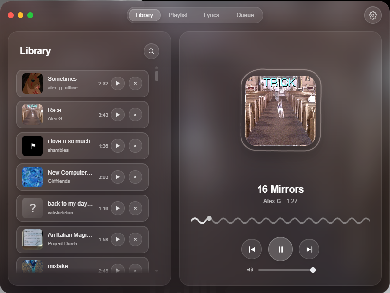
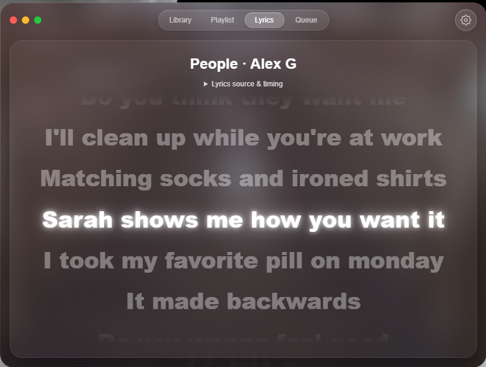
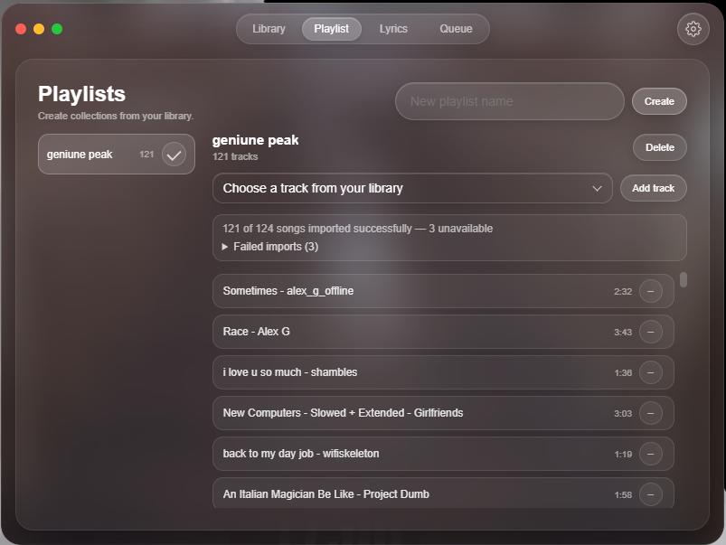
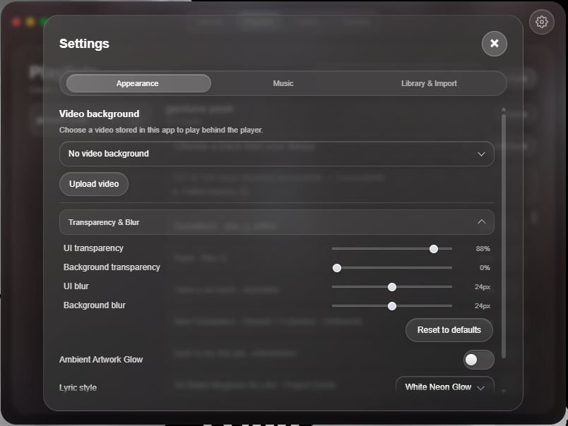

# RefractPlayer

A free, open-source music player for Windows.

RefractPlayer is a desktop music player built around a simple idea: finding, downloading and listening to your music shouldn't be complicated.

Import music from supported links, organize your library, customize the interface and listen locally without needing a browser open.

## Screenshots

### Library

### Lyrics

### Playlists

### Appearance settings

## Features

- **Music downloads** — Search for songs and save them directly to your library.
- **Playlist importing** — Import music from Spotify, YouTube Music and SoundCloud links.
- **Local playback** — Listen to your downloaded music without an internet connection.
- **Synced lyrics** — Follow along with timed lyrics, including multiple visual styles and timing adjustments.
- **Customizable appearance** — Adjust the look and feel of the player.
- **Library management** — Organize your music and playlists in one place.
- **Automatic retries** — Failed downloads can be retried without starting the entire import again.
- **MP3 and M4A support** — Choose the format that works best for you.

## Download

Head to the [Releases](../../releases) page and download the latest Windows installer.

Both `.exe` and `.msi` installers may be available.

RefractPlayer is currently an early release, so you might run into the occasional bug.

If something isn't working, feel free to open an issue.

## How to use

1. Install and open RefractPlayer.
2. Search for a song or paste a supported music link.
3. Import the music you want.
4. Play it from your library.

That's it.

## Built with

- Tauri
- Rust
- TypeScript
- spotDL
- yt-dlp
- FFmpeg

RefractPlayer bundles the media tools it needs, so you shouldn't have to install Python or FFmpeg separately.

## Known limitations

Some tracks may not be available or may fail to match correctly, particularly obscure remixes, alternate versions and unofficial uploads.

Synced lyrics depend on third-party sources and may occasionally need manual timing adjustments.

## Contributing

Contributions, bug reports and suggestions are welcome.

If you find an issue or have an idea for an improvement, open a GitHub issue.

## Disclaimer

RefractPlayer is an independent project and is not affiliated with Spotify, YouTube, SoundCloud or their respective owners.

Music and artwork belong to their respective copyright holders. Users are responsible for ensuring they have permission to download and use content and for complying with applicable laws and service terms.

## A note about development

RefractPlayer is a vibe-coded project.

Most of the code was written with the help of AI, with the ideas, design decisions, testing and direction coming from me.

I'm not going to pretend I hand-wrote every line. This started as a personal project to make a music player I'd actually want to use, and it gradually turned into something worth sharing.

It's still a work in progress, and contributions, bug reports and suggestions are welcome.

## License

RefractPlayer is released under the GNU General Public License v3.0 (GPL-3.0).

You're free to use, study, modify and redistribute the project under the terms of the license.

If you distribute a modified version, you must also make the corresponding source code available under GPL-3.0.

See the [LICENSE](LICENSE) file for the full terms.

